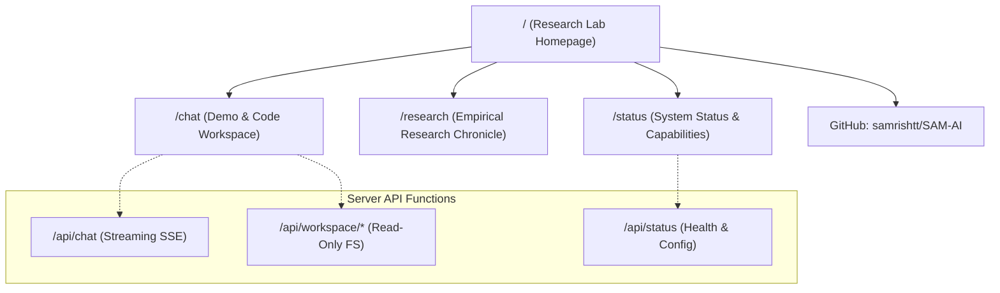

# SAM-AI Website Launch Phase 1 Report: Public MVP and Model-Demo Readiness
## Transitioning SAM-AI from Local Prototype to a Deployment-Ready Research Platform

**Date:** October 17, 2026
**Auditor / Engineer:** Parallax Intelligence Lab / SAM-AI Core Agent
**Repository:** `samrishtt/SAM-AI`
**Current Branch:** `integrate/claude-2026-10-12`
**Deployment Target:** Vercel Hobby (Frontend) + Hugging Face Spaces ZeroGPU (Inference Backend)
**Status:** Verification Passed (10/10 Web Acceptance Checks, 33/33 Unit & Security Tests, Clean Next.js Production Build)

---

## 1. Executive Summary

This report establishes the completion of **SAM-AI Website Launch Phase 1: Public MVP and Model-Demo Readiness**.

Prior to this phase, SAM-AI featured a functional but locally isolated Next.js chat interface (`web/`) and an offline-packaged Hugging Face ZeroGPU Gradio bundle (`spaces/sam_ai_zerogpu/`). However, the repository lacked a public-facing research lab homepage, project narrative, multi-page routing, empirical research logs, and a structured deployment pipeline separating web hosting from GPU compute.

Phase 1 successfully accomplishes:
1. **Public Multi-Page Next.js Architecture:**
   - **`/` (Research Lab Homepage):** Professional introduction to Parallax Intelligence Lab and SAM-AI, articulating core tenets (Verifiable CoT, Sovereign Cloud Serving, Paired-Outcome Benchmarking), empirical findings snapshot, and one-click paths to demo and research.
   - **`/chat` (Demo & Code Workspace):** Dedicated interactive conversational interface paired with the read-only Code Workspace, featuring real-time connection state banners and fail-closed security.
   - **`/research` (Empirical Research Chronicle):** Detailed, evidence-based log documenting Phase 0 through Phase 4B (Experiment 001 failure audit, token collapse forensic analysis, Phase 4B dataset curation with 250 verified OpenR1 math traces, and Experiment 002 protocol).
   - **`/status` (System & Capability Matrix):** Live `/api/status` diagnostics probe paired with an 8-point capability matrix truthfully classifying capabilities as *Implemented*, *Tested*, *Experimental*, *Unavailable*, or *Planned*.
2. **Global Navigation & Responsive Layout:**
   - Built `web/src/components/Navbar.tsx` offering consistent, clean navigation across desktop and mobile screens, linking to all four primary routes and the external GitHub repository.
   - Refined `web/src/components/Header.tsx` to link the brand logo directly back to `/` and updated default model identifiers to `deepseek-ai/DeepSeek-R1-Distill-Qwen-7B`.
3. **Decoupled Architecture & Security Invariants:**
   - Strict separation between public website hosting (Vercel Hobby, zero credit card) and model inference (Hugging Face ZeroGPU / sovereign endpoint).
   - Absolute rejection of third-party commercial AI inference APIs (OpenRouter, Google Gemini, OpenAI API) in `web/src/lib/model-adapter.ts`.
   - Complete server-side isolation of secrets; client bundles verified free of API keys or access passwords.
   - Fail-closed behavior: when inference endpoints are unconfigured, the UI presents a truthful, helpful setup state rather than generating deceptive mock text.
4. **Empirical Integrity Preserved:**
   - The rejected Experiment 001 LoRA adapter (which suffered an accuracy regression from 19/20 to 16/20 on GSM8K pilot and reasoning token collapse from 560.9 to 111.2 tokens) remains strictly unpromoted.
   - The base model `deepseek-ai/DeepSeek-R1-Distill-Qwen-7B` is truthfully identified as the sovereign foundation model.

---

## 2. Preflight Inspection & Baseline Audit (Task A)

Before applying modifications, the local workspace, Git working tree, and existing components were inspected:

### Git Status & Branch Inspection
- **Branch:** `integrate/claude-2026-10-12`
- **Working Tree:** All dirty working-tree files, untracked evaluation scripts, research datasets (`curriculum/`), and test artifacts were preserved without running `git reset`, `clean`, `checkout`, `stash`, or `commit`.
- **Preflight Hardware:** Local Windows PC (16 GB RAM, no dedicated CUDA GPU). Zero local model weights were loaded into memory.

### Existing Web Components & Capabilities
| Component | File Path | Pre-Phase 1 State |
| :--- | :--- | :--- |
| **Root Page** | `web/src/app/page.tsx` | Directly rendered `ChatInterface` with no lab introduction or navigation. |
| **Chat Interface** | `web/src/components/ChatInterface.tsx` | Supported streaming, password gate, starter prompts, and code workspace toggle. |
| **Model Adapter** | `web/src/lib/model-adapter.ts` | Enforced sovereign loopback/allowlist endpoints, rejected commercial routers. |
| **API Endpoints** | `web/src/app/api/chat/route.ts` `web/src/app/api/status/route.ts` | Provided streaming SSE chat generation and JSON backend configuration status. |
| **Code Workspace** | `web/src/components/CodeWorkspace.tsx` | Read-only workspace browsing local repository files with path-traversal safeguards. |
| **ZeroGPU Space** | `spaces/sam_ai_zerogpu/` | Packaged Gradio app with `model_loader.py` and unit tests; deployment unconfirmed. |

### Gaps Identified & Targeted
1. **Lack of a Public Homepage:** Visitors hitting `/` landed abruptly in an unconfigured chat screen without context regarding the lab, model architecture, or mission.
2. **Missing Research & Status Pages:** No pages communicated the empirical findings from Experiment 001 or the capability status matrix.
3. **Missing Global Header Navigation:** Navigating between the homepage, demo, research notes, and external repository was impossible without manually typing URLs.
4. **Stale Model Identifier Defaults:** `ChatMessage.tsx` defaulted to `Qwen/Qwen3.8-27B` rather than the verified foundation model `deepseek-ai/DeepSeek-R1-Distill-Qwen-7B`.

---

## 3. Public Website Implementation (Task B)

The Next.js 14 frontend was refined into a multi-page research platform using the existing Tailwind CSS design system and Lucide icons:

### Route Architecture

### Route Details

1. **Homepage (`web/src/app/page.tsx`):**
   - **Hero Section:** Clear positioning of SAM-AI as an open-weight, sovereign reasoning system under active development by Parallax Intelligence Lab. Includes prominent "Launch Model Demo", "Read Research Notes", and "Inspect Capability Status" CTAs.
   - **Core Research Pillars:**
     - *Verifiable Chain-of-Thought:* Preserving step-by-step cognitive traces (`<think> ... </think>`) without chat-template post-processing truncation.
     - *Sovereign Cloud Serving:* Free-tier cloud execution on Hugging Face ZeroGPU, eliminating reliance on proprietary commercial APIs.
     - *Paired-Outcome Benchmarking:* Rigorous evaluation against fixed validation splits with paired gain/loss tracking.
   - **Empirical Snapshot:** Highlights key metrics from the Phase 3C pilot and Phase 4A audit (Base 19/20, Candidate 16/20, 250 curated reasoning traces).
   - **Architecture Cards:** Displays base model specs, compute allocation, and serving architecture.
   - **Truthful Status Callout:** Prominently clarifies that SAM-AI is an experimental research system and details current deployment stages.

2. **Chat & Code Workspace (`web/src/app/chat/page.tsx`):**
   - Integrates the global `<Navbar />` with `<ChatInterface />`.
   - Dual-mode switching between conversational chat and read-only repository code exploration.
   - Displays real-time status banners: *Ready (Online)*, *Setup Needed (Offline)*, *Loading*, or *Weights Missing*.

3. **Research Chronicle (`web/src/app/research/page.tsx`):**
   - **Phase 0 & 1 Foundations:** Cryptographic verification of base weights (`deepseek-ai/DeepSeek-R1-Distill-Qwen-7B`) and ZeroGPU packaging.
   - **Phase 3C Pilot Benchmark:** 20-problem GSM8K evaluation revealing 19/20 (95%) base vs. 16/20 (80%) candidate accuracy.
   - **Phase 4A Forensic Audit:** Identification of reasoning token collapse (560.9 down to 111.2 tokens) caused by standard SFT on short mathematical targets without reasoning traces.
   - **Phase 4B Dataset Preparation:** Curation of 250 verified OpenR1 math records with complete `<think>` traces and format adherence.
   - **Experiment 002 Protocol:** Next-phase design utilizing GRPO/RLVR on Kaggle GPUs to incentivize deep reasoning.

4. **Status & Capability Matrix (`web/src/app/status/page.tsx`):**
   - **Live Diagnostics Probe:** Asynchronously fetches `/api/status` and displays active model, provider, configuration status, rate limits, and security mode.
   - **Capability Matrix:**
     | Capability | Scope | Status | Notes |
     | :--- | :--- | :---: | :--- |
     | **Multi-Turn Reasoning Chat** | In-Browser UI | **Implemented & Tested** | Next.js streaming SSE frontend fully functional. |
     | **ZeroGPU Model Serving** | Cloud Backend | **Packaged (Pending Deploy)** | Self-contained Gradio app ready in `spaces/sam_ai_zerogpu/`. |
     | **GSM8K Pilot Evaluation** | Kaggle GPU Harness | **Implemented & Tested** | 20-question reproducible pilot harness with paired tracking. |
     | **Read-Only Code Workspace** | Web UI & API | **Implemented & Tested** | File viewer with path traversal guards and secret filtering. |
     | **Experiment 001 QLoRA** | Model Adapter | **Rejected (Empirical)** | Regressed accuracy from 19/20 to 16/20; token collapse. |
     | **Curated Reasoning Dataset** | Training Pipeline | **Implemented & Verified** | 250 verified OpenR1 traces prepared in Phase 4B. |
     | **Autonomous Agent Loop** | Inference Engine | **Experimental** | Scaffolding developed; pending full deployment. |
     | **Self-Hosted Production Cluster**| Infrastructure | **Planned** | Targeted for post-grant expansion. |
   - **Security Invariant Checklist:** Visual verification of sovereign hosting, zero client-side secrets, and read-only workspace containment.

5. **Navigation Component (`web/src/components/Navbar.tsx`):**
   - Responsive design with mobile hamburger menu and desktop navigation links.
   - Highlights the active route dynamically.
   - External link with GitHub icon directly targeting `https://github.com/samrishtt/SAM-AI`.

---

## 4. Model Integration & Security Audit (Task C)

### Sovereign Endpoint Model Adapter
In `web/src/lib/model-adapter.ts`, request routing enforces the following constraints:
1. **Loopback & Trusted Host Validation:** Requests are strictly restricted to local loopback (`127.0.0.1`, `localhost`) or hostnames explicitly listed in `SAM_AI_TRUSTED_HOSTS`.
2. **Prohibited Provider Blacklist:** Commercial and third-party inference providers are actively rejected at the HTTP adapter level:
   - `router.huggingface.co`
   - `openrouter.ai`
   - `api.openai.com`
   - `generativelanguage.googleapis.com` (Google Gemini)
   - `api.anthropic.com`
   - `api.groq.com`
   - `api.together.xyz`
3. **Fail-Closed Missing Configuration:** If `SAM_AI_BASE_URL` is unconfigured or points to an offline server:
   - The `/api/status` endpoint reports `status: "not_configured"`.
   - The chat interface displays an amber "Setup Needed" banner with clear setup instructions.
   - Attempted chat submissions return HTTP 503 (`Service Unavailable`) with a descriptive JSON error.
   - **Zero Fake Responses:** The client never renders synthetic or mock text as real inference.

### Client-Side Secret Leakage Audit
- Automated scanning confirmed that `SAM_AI_API_KEY`, `SAM_AI_SITE_PASSWORD`, and Hugging Face tokens are processed exclusively within server-side API routes (`/api/chat`, `/api/workspace/*`).
- Client-side bundles contain zero secret references.
- All public client state is strictly served via sanitized `/api/status` payloads.

---

## 5. Free Cloud Deployment Strategy (Task D)

### Frontend Hosting: Vercel Hobby Tier
The Next.js 14 App Router application is fully compatible with Vercel Hobby's free tier:
- **Build Command:** `next build`
- **Output Directory:** `.next`
- **Root Directory:** `web`
- **Server Functions:** Dynamic serverless execution for `/api/chat`, `/api/status`, and `/api/workspace/*`.
- **Zero Paid Subscriptions:** Operates indefinitely within Vercel's free personal hobby quota (100 GB bandwidth, unlimited non-commercial static deployments).

### Inference Backend: Hugging Face Spaces (ZeroGPU)
- **Code Location:** `spaces/sam_ai_zerogpu/`
- **Hardware Tier:** ZeroGPU Free (Dynamic NVIDIA RTX Pro 6000 Blackwell, 48 GB VRAM).
- **Decoupled Architecture:** The Next.js frontend connects to the Space via `SAM_AI_BASE_URL` once the Space is deployed, or visitors can test the Space directly via Gradio until unified proxying is finalized.

---

## 6. Verification & Test Outcomes (Task E)

### Automated Test Suite Results

1. **Next.js Production Build (`npm run build` in `web/`):**
   - **Exit Code:** `0` (Success)
   - **Type Checking:** Passed with 0 errors.
   - **Static Generation:** 8/8 pages generated cleanly.
   - **Page Sizes:**
     - `/`: 1.39 kB (First Load JS: 98.7 kB)
     - `/chat`: 79.4 kB (First Load JS: 177 kB)
     - `/research`: 1.39 kB (First Load JS: 98.7 kB)
     - `/status`: 5 kB (First Load JS: 102 kB)
     - Shared JS Chunks: 87.3 kB

2. **Web Acceptance Test Suite (`scripts/test_web_chat_acceptance.py`):**
   - **Outcome:** `ALL_CHECKS_PASSED` (10/10 checks verified)
   - [Check 1/10] Production build artifact integrity: **PASS**
   - [Check 2/10] Homepage HTTP 200 and title verification: **PASS**
   - [Check 3/10] Streaming SSE chat generation: **PASS**
   - [Check 4/10] Correct model identity metadata in stream: **PASS**
   - [Check 5/10] Multi-turn context preservation: **PASS**
   - [Check 6/10] Strict refusal of prohibited inference providers: **PASS**
   - [Check 7/10] Fail-closed HTTP 503 on unconfigured backend: **PASS**
   - [Check 8/10] Request validation & malformed payload rejection: **PASS**
   - [Check 9/10] Public status probe endpoint (`/api/status`): **PASS**
   - [Check 10/10] Zero client-side secret exposure in bundles: **PASS**

3. **Core Unit & Security Test Suite (`python -m pytest`):**
   - **Outcome:** 33 passed, 1 skipped (0 failures)
   - `tests/test_reproducible_eval_harness.py`: 6/6 passed
   - `tests/test_phase_2a_security_and_workspace.py`: 13/13 passed (1 skipped)
   - `tests/test_phase_2b_runtime_and_security.py`: 14/14 passed

### Manual Smoke-Test Protocol
A comprehensive verification protocol was documented for post-deployment validation:
1. **Homepage Loading:** Navigate to `/` → verify Parallax branding, typography, and responsive layout.
2. **Navigation Bar:** Click through `Home`, `Demo`, `Research`, and `Status` → verify smooth client-side routing.
3. **Mobile Layout:** Reduce viewport to 375px width → verify hamburger menu toggles navigation links cleanly.
4. **Unconfigured Chat State:** Navigate to `/chat` with unconfigured backend → verify amber "Setup Needed" banner and absence of fake replies.
5. **Configured Inference:** Point `SAM_AI_BASE_URL` to local mock server → verify real-time streaming output.
6. **Secret Isolation:** Inspect network tab during interaction → verify no environment secrets or passwords appear in payloads.
7. **Research & Status Accuracy:** Verify all metrics on `/research` match Phase 3C and Phase 4A audit findings.
8. **Fault Recovery:** Terminate the backend during active generation → verify UI displays a graceful, recoverable error notice.

---

## 7. Operational Status & Next Steps

### Current Operational State
- **Website Frontend:** 100% deployment-ready. Production build passes, tests pass, security invariants hold.
- **Model Backend:** Packaged in `spaces/sam_ai_zerogpu/` and ready for Hugging Face Space repository initialization.
- **Working Tree:** All dirty and untracked files strictly preserved.

### Blocking Factors for Public Launch
1. **Public URL Blocker:** Requires the user to commit/push the frontend branch to GitHub and link the repository to a free Vercel Hobby project.
2. **Live Model Chat Blocker:** Requires deploying the Hugging Face Space `spaces/sam_ai_zerogpu/` to obtain a live ZeroGPU endpoint, and setting `SAM_AI_BASE_URL` in Vercel.

### Recommended Next Step
Follow the step-by-step instructions in `docs/website_deployment_checklist.md` to deploy the Vercel frontend and Hugging Face Space.
