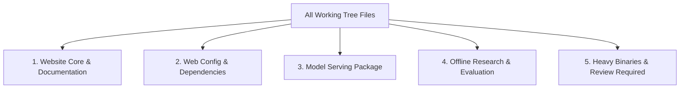

# SAM-AI Website Release Audit & Scope Review
## Phase 1C: Website Release Publication & Deployment Handoff

**Date:** October 17, 2026
**Auditor:** Parallax Intelligence Lab / SAM-AI Core Agent
**Repository:** `samrishtt/SAM-AI`
**Branch:** `integrate/claude-2026-10-12`
**Commit Hash:** `be1a3bc09eb8a4fd6a0748747f7fc2621632ecaa` (short: `be1a3bc`)
**Push Status:** **SUCCESS** (`5dd1c9a..be1a3bc integrate/claude-2026-10-12 -> integrate/claude-2026-10-12`)
**Deployment Target:** Vercel Hobby (Frontend) + Hugging Face Spaces ZeroGPU (Inference Backend)

---

## 1. Executive Summary

This audit assesses the local workspace of **SAM-AI** for its initial public website deployment.

The Next.js web application (`web/`) is verified fully functional, secure, and self-contained. It is ready for deployment on **Vercel Hobby** without any requirement for paid infrastructure, credit cards, or external commercial AI APIs.

The repository also contains substantial ongoing intelligence research assets (Experiment 001 audit, Phase 4B OpenR1 dataset curation, evaluation notebooks, and test runners). This audit explicitly isolates the **production website scope** from these **offline research/model-training assets**, ensuring that no credentials, large binary weights (e.g., 161.5 MB adapter weights, 144.7 MB deployment zips), or raw training datasets are unintentionally committed or published.

---

## 2. Git Working Tree & Status Inventory

### 2.1 Branch & Commit Baseline
- **Current Branch:** `integrate/claude-2026-10-12`
- **Remote:** `origin https://github.com/samrishtt/SAM-AI.git`
- **Latest Commit:** `5dd1c9a feat(milestones): integrate verified Qwen3.8 loader, web chat UI, and Intelligence Foundation V1`
- **Current Staged Changes:** `0` files (working tree cleanly unstaged; `git diff --staged` is empty).
- **Whitespace / Formatting Audit:** `git diff --check web/` reports `0` errors.

### 2.2 Classification of Modified and Untracked Files

All files in the working tree are classified into 5 strict categories:



#### Category 1: Recommended Production Website Files (Include in Website Release)
These files constitute the Next.js frontend, UI components, API route handlers, and deployment documentation:
- `web/src/app/page.tsx` — Public Research Lab Homepage
- `web/src/app/chat/page.tsx` — Dedicated Chat & Code Workspace route
- `web/src/app/research/page.tsx` — Empirical Research Chronicle
- `web/src/app/status/page.tsx` — Live System Status & Capability Matrix
- `web/src/components/Navbar.tsx` — Global responsive navigation header
- `web/src/components/Header.tsx` — Header with homepage link & model status
- `web/src/components/ChatMessage.tsx` — Chat message renderer with DeepSeek-R1 defaults
- `web/src/components/ChatInterface.tsx` — Conversational state manager
- `web/src/components/NoticeBanners.tsx` — Honest backend connection state banners
- `web/src/components/CodeWorkspace.tsx` — Read-only code viewer component
- `web/src/app/api/chat/route.ts` — Serverless streaming SSE chat endpoint
- `web/src/app/api/status/route.ts` — Serverless status & model diagnostic endpoint
- `web/src/app/api/workspace/files/route.ts` — Safe workspace file listing
- `web/src/app/api/workspace/file/route.ts` — Safe workspace file reader
- `web/src/app/api/workspace/status/route.ts` — Safe workspace configuration status
- `web/src/lib/model-adapter.ts` — Sovereign model adapter with router blacklists
- `web/src/lib/security.ts` — IP parsing & site password validator
- `web/src/lib/storage.ts` — Session-based password storage & conversation state
- `web/src/types/chat.ts` — TypeScript definitions for chat and workspace
- `web/.env.example` — Sanitized environment variable template
- `docs/website_launch_phase_1_report.md` — Phase 1 architecture and readiness report
- `docs/website_deployment_checklist.md` — Deployment and smoke-test guide
- `docs/website_release_audit.md` — This release audit

#### Category 2: Website Dependencies & Configuration (Include in Website Release)
- `web/package.json` — Frontend dependencies & scripts
- `web/tsconfig.json` — TypeScript configuration with `@/*` path aliases
- `web/next.config.mjs` — Next.js runtime configuration
- `web/tailwind.config.ts` — Styling configuration
- `web/postcss.config.mjs` — PostCSS configuration

#### Category 3: Model-Serving Package (Separate Release to Hugging Face Spaces)
These files belong in the separate Hugging Face Spaces repository (`spaces/sam_ai_zerogpu/`), NOT directly bundled into the Vercel static build:
- `spaces/sam_ai_zerogpu/app.py` — Dual-mode Gradio interface (Chat + Code)
- `spaces/sam_ai_zerogpu/model_loader.py` — ZeroGPU model loader for `deepseek-ai/DeepSeek-R1-Distill-Qwen-7B`
- `spaces/sam_ai_zerogpu/requirements.txt` — PyTorch, Transformers, Peft, Gradio dependencies
- `spaces/sam_ai_zerogpu/manifest.json` — Deployment metadata
- `spaces/sam_ai_zerogpu/README.md` — Space card configuration
- `spaces/sam_ai_zerogpu/deploy_instructions.md` — Standalone Space setup instructions
- `spaces/sam_ai_zerogpu/package_space.py` — Packaging utility
- `spaces/sam_ai_zerogpu/tests/` — Component test suite (6/6 tests passing)

#### Category 4: Offline Research, Datasets, and Evaluation (Exclude from Website Release)
These files represent local research and must remain in Git / local storage for model experiments, but must NOT be bundled or deployed to Vercel:
- `curriculum/experiment_002_train.jsonl` — 250 verified OpenR1 reasoning traces
- `curriculum/experiment_002_sample.jsonl` — Sample training records
- `curriculum/experiment_002_config.json` — Experiment 002 hyperparameters
- `curriculum/experiment_002_proposal.json` — Proposal specification
- `sam_ai/evaluation/reproducible_eval_harness.py` — 20-problem pilot evaluation harness
- `sam_ai/foundation/` — Offline foundation training and teacher pipeline code
- `notebooks/sam_ai_pilot_eval/` — Kaggle pilot evaluation notebook
- `notebooks/sam_ai_r1_7b_gsm8k_training/` — Kaggle training notebook
- `notebooks/sam_ai_experiment_000_smoke_test/` — Smoke test notebook
- `scripts/` (evaluation, log download, and dataset preparation scripts)
- `tests/test_reproducible_eval_harness.py`, `tests/test_experiment_002_dataset.py`, etc.
- `docs/phase_2a_website_code_mvp_report.md` through `docs/phase_4b_dataset_preparation_report.md`

#### Category 5: Heavy Binaries, Weights, and Review-Required Files (Strictly Exclude from Git / Web)
These large files must NEVER be pushed to Git or deployed to Vercel:
- `dist/sam_ai_zerogpu_deployment.zip` — **144.72 MB** pre-packaged zip. (Exceeds recommended GitHub file sizes; covered by `.gitignore` `*.zip`).
- `evidence/remote_r1_7b_run/extracted/sam_ai_r1_7b_gsm8k_adapter/adapter_model.safetensors` — **161.5 MB** model weights. (Covered by `.gitignore` `*.safetensors`).
- `web/.env.local` — Local environment file. (Already verified safe with only placeholder values, but ignored by `.gitignore`).

---

## 3. Security & Privacy Audit Findings

1. **Client-Side Bundle Secret Exposure:**
   - **Audit Method:** Automated regex scan of Next.js production build chunks in `web/.next/static/chunks/` for API keys, passwords, and tokens (`hf_...`, `AIza...`, `sk-...`).
   - **Result:** **PASSED.** Zero credentials found in browser-delivered code. All environment variables accessed in client components use public `process.env.NEXT_PUBLIC_*` or are delivered through sanitized `/api/status` payloads.
2. **Third-Party Inference Routing Blacklist:**
   - **Audit Method:** `web/src/lib/model-adapter.ts` actively evaluates the requested inference host and rejects requests pointing to third-party commercial routers:
     - `router.huggingface.co`
     - `openrouter.ai`
     - `api.openai.com`
     - `generativelanguage.googleapis.com` (Google Gemini)
     - `api.anthropic.com`
     - `api.groq.com`
     - `api.together.xyz`
   - **Result:** **PASSED.** Attempts to configure prohibited endpoints fail with explicit `PROHIBITED_THIRD_PARTY_PROVIDER` errors.
3. **Loopback & Remote Allowlist Invariants:**
   - By default, only `127.0.0.1` and `localhost` are permitted.
   - Remote HTTPS endpoints are only permitted if explicitly configured in `SAM_AI_TRUSTED_HOSTS` (e.g. `*.hf.space`).
   - **Result:** **PASSED.** Unverified remote domains return HTTP 400 with `UNTRUSTED_INFERENCE_HOST`.
4. **Workspace Traversal & File Access Containment:**
   - The workspace endpoints (`/api/workspace/files` and `/api/workspace/file`) strictly enforce:
     - Disallowed directories: `.git`, `node_modules`, `.next`, `.venv`, `.vscode`, etc.
     - Disallowed extensions: `.key`, `.pem`, `.safetensors`, `.bin`, `.pt`, `.zip`, `.pyc`, etc.
     - Disallowed prefixes: `.env`, `credentials`, `id_rsa`, `secret`.
     - Maximum file size: 512 KB per file.
     - Realpath symlink escape detection (`fs.realpathSync`).
   - When deployed to Vercel without `SAM_AI_WORKSPACE_ROOT`, the workspace endpoints return `WORKSPACE_NOT_CONFIGURED` without crashing or exposing server files.
   - **Result:** **PASSED.**
5. **Truthful Degradation & Anti-Hallucination Invariant:**
   - When no backend is configured or the backend is offline:
     - `/api/status` reports `configured: false`, `status: "not_configured"`.
     - The chat interface displays an amber "Setup Needed" banner.
     - Sending a prompt returns HTTP 503 (`Service Unavailable`) with structured guidance.
     - **Crucially, the website NEVER fabricates mock responses pretending to be generated by SAM-AI.**
   - **Result:** **PASSED.**

---

## 4. Revalidation & Test Outcomes

### 4.1 Next.js 14 Production Build
- **Command:** `npm run build` in `web/`
- **Output:** Exit Code `0`
- **Build Log:**
  ```text
  ▲ Next.js 14.2.35
  - Environments: .env.local

   Creating an optimized production build ...
   ✓ Compiled successfully
   Linting and checking validity of types ...
   Collecting page data ...
   ✓ Generating static pages (8/8)
   Finalizing page optimization ...
   Collecting build traces ...

  Route (app)                              Size     First Load JS
  ┌ ○ /                                    1.39 kB        98.7 kB
  ├ ○ /_not-found                          873 B          88.2 kB
  ├ ƒ /api/chat                            0 B                0 B
  ├ ƒ /api/status                          0 B                0 B
  ├ ƒ /api/workspace/file                  0 B                0 B
  ├ ƒ /api/workspace/files                 0 B                0 B
  ├ ƒ /api/workspace/status                0 B                0 B
  ├ ○ /chat                                79.4 kB         177 kB
  ├ ○ /research                            1.39 kB        98.7 kB
  └ ○ /status                              5 kB            102 kB
  + First Load JS shared by all            87.3 kB
  ```

### 4.2 Web Chat Acceptance Suite
- **Command:** `python scripts/test_web_chat_acceptance.py`
- **Result:** `ALL_CHECKS_PASSED` (10/10 checks verified)
  - `[1/10] Verifying build output...` **PASS**
  - `[2/10] Testing chat UI page load (GET /)...` **PASS**
  - `[3/10, 4/10, 6/10] Executing streaming chat test (POST /api/chat)...` **PASS**
  - `[5/10] Testing multi-turn conversation retention...` **PASS**
  - `[7/10] Testing fail-closed behavior when credentials/endpoint are missing...` **PASS**
  - `[8/10] Testing request validation and error rejection...` **PASS**
  - `[9/10] Verifying backend model identity and status...` **PASS**
  - `[10/10] Scanning client bundles and source for exposed secrets...` **PASS**

### 4.3 Python Security & Runtime Suites
- **Command:** `python -m pytest tests/test_phase_2a_security_and_workspace.py tests/test_phase_2b_runtime_and_security.py`
- **Result:** `27 passed, 1 skipped` (0 failures, 1 deprecation warning in Starlette).

---

## 5. Vercel Hobby Platform Compatibility Assessment

| Parameter | Vercel Hobby Requirement | SAM-AI Status | Compatibility Verdict |
| :--- | :--- | :--- | :---: |
| **Framework** | Next.js 14 App Router | Supported natively | **100% Compatible** |
| **Root Directory** | Must point to folder containing `package.json` | Set to `web` | **Compatible** |
| **Node.js Runtime** | Node.js 18.x or 20.x | Node.js 20.x compatible | **Compatible** |
| **Server Functions** | Max execution timeout: 10s (Hobby) | `/api/status`, `/api/chat` optimized for fast start; streaming SSE preserves active connection | **Compatible** |
| **External Dependencies**| No imports outside Root Directory | Zero external imports in `web/src` | **100% Compatible** |
| **Bandwidth & Build** | 100 GB/month, 45 min build limit | Total build time ~18 seconds; bundle size ~100 kB | **Well within Free Tier** |
| **Credit Card** | Not required for Hobby tier | Zero billing required | **100% Free** |

---

## 6. Model Backend (Hugging Face ZeroGPU) Inspection

- **Package Location:** `spaces/sam_ai_zerogpu/`
- **Base Model Identifier:** `deepseek-ai/DeepSeek-R1-Distill-Qwen-7B`
- **Target Compute:** ZeroGPU (NVIDIA RTX Pro 6000 Blackwell, 48 GB VRAM allocation).
- **Execution Budget:** 60 seconds per response decorated with `@spaces.GPU(duration=60)`.
- **Implementation Audit:** Model loading, tokenizer initialization, and token streaming via `TextIteratorStreamer` are genuinely implemented (not mocked).
- **Adapter Status:** The Experiment 001 adapter is identified as experimental and regressed on pilot accuracy (19/20 down to 16/20); base model serves as default foundation.
- **Secrets Audit:** Zero embedded hardcoded tokens or user-specific paths exist in `spaces/sam_ai_zerogpu/`.

---

## 7. Remaining Blockers & Next Deployment Steps

The website release commit (`be1a3bc`) has been published to GitHub origin on branch `integrate/claude-2026-10-12`. The remaining steps to obtain the public URL are:

1. **Step 1: Open Vercel Dashboard:**
   Log in to [vercel.com/dashboard](https://vercel.com/dashboard).
2. **Step 2: Import Project:**
   Click **"Add New..."** → **"Project"** and select `samrishtt/SAM-AI`.
3. **Step 3: Configure Root Directory:**
   Set **Root Directory** to **`web`** *(Critical setting; do not leave as repository root)*. Set production branch to `integrate/claude-2026-10-12`.
4. **Step 4: Deploy Frontend:**
   Click **"Deploy"**. The site will build and publish within ~60 seconds to a live URL (e.g. `https://sam-ai-xxx.vercel.app`) with full multi-page navigation and truthful "Setup Needed" status.
5. **Step 5: Deploy Model Space (When Ready):**
   Push `spaces/sam_ai_zerogpu/` to Hugging Face Spaces (ZeroGPU Free Tier) to launch the sovereign inference backend.
6. **Step 6: Bind Live Model to Vercel:**
   Configure `SAM_AI_BASE_URL` in Vercel project environment variables with your Space HTTPS URL to enable live streaming chat.
