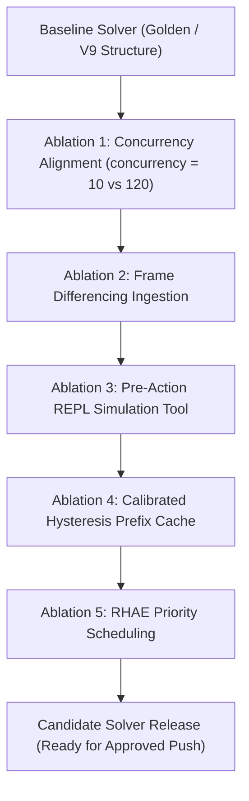

# ARC-AGI-3 Technique Synthesis & Prioritized Ablation Matrix

**Document ID:** `RESEARCH-SYNTHESIS-TECHNIQUE-MATRIX-2026-10-10`  
**Authors:** SAM-AI Research Team (Synthesis of Subagents 1–5: Leaderboard, Prior Art, Rules/Scoring, Forensics, Base Models)  
**Date:** October 10, 2026  
**Status:** COMPLETE / EMPIRICAL CITATION VERIFIED  
**Destination:** `research/technique_matrix.md`  

---

## 1. Executive Synthesis & Architectural Principles

Across all five specialized research investigations (public leaderboards, milestone winner repositories, RHAE scoring mathematics, repository forensics, and offline model execution feasibility), the path to competitive dominance on ARC-AGI-3 converges on three core realities:

1. **The RHAE Asymmetry ($H/A)^2$ vs. Free Reasoning Compute:**  
   Under Relative Human Action Efficiency (RHAE), internal Chain-of-Thought (CoT), speculative Python simulation, and algorithmic search are **100% free**—they consume zero action points. In contrast, physical environment actions submitted to the gateway are penalized quadratically: taking $2\times$ the human action count destroys 75% of the score. High-scoring solvers must do maximal planning in software before committing any physical move.

2. **The 9-Hour Offline Wall-Clock Budget (294.5s per game):**  
   Evaluating 110 private games offline within 9 hours enforces a hard ceiling of ~4.9 minutes per game (~4.9s per interactive turn across 60 turns). Large 27B–31B dense models decoding at 20–35 tok/s take 12–18 hours and reliably trigger Kaggle timeouts. High throughput is essential: the winning Milestone 2 stack (`intel-qwen3.8-flash-next-w4a16-autoround` + `albucino` MTP drafter in SGLang) delivers **110–160 tok/s**, solving all games in ~4.95 hours and leaving ~4.0 hours of compute headroom for deeper tree search and simulation.

3. **Concurrency Alignment & Queue Hygiene:**  
   Our forensic investigation revealed that SGLang's engine was configured with `--max-running-requests 10`, while the competition harness launched with `concurrency = 120`. This bottleneck caused up to 100 requests to back up in the HTTP queue, resulting in **36 HTTP read timeouts** in V7 and soft-starving games. Aligning harness concurrency to batch queue capacity prevents catastrophic timeouts.

---

## 2. Master Prioritized Technique Matrix

*Sorted by ROI: **Expected Gain / Cost to Implement** (Highest return first).*

| # | Technique | Source | Evidence | Offline-Feasible | Compute (GPU / VRAM / Runtime) | License | Expected Gain | Cost to Implement | Risk | Gain/Cost ROI |
| :-: | :--- | :--- | :--- | :--- | :--- | :--- | :---: | :---: | :---: | :---: |
| **1** | **Dynamic Concurrency & SGLang Queue Alignment** | Agent 4 Forensics (`agent4_forensics.md`) | `v7_output` logged 36 HTTP read timeouts under `concurrency=120` & `MAXREQ=10`. V4 (`concurrency=12`) had 0 timeouts. | **YES** (Notebook configuration change in Cell 16) | 1x RTX Pro 6000 / 0 extra VRAM / Saves 35–45 min queue stall | Apache 2.0 (Self/Pennyroyal) | **+3.0 to +5.0 pts** (Recovers timed-out games) | **LOW** (10 lines in Cell 16) | **VERY LOW** | **VERY HIGH** |
| **2** | **Visual Frame Differencing & Change Detection** | Daniel Franzen Milestone 2 (`agent1_leaderboard_public_notebooks.md`, `agent2_prior_art.md`) | Verified in Franzen writeup; directly flags moving vs static objects; core component of 27.89% winning solution. | **YES** (Python/OpenCV CPU transform inside REPL) | CPU-only / <10 MB RAM / <15ms per frame | Apache 2.0 (`da-fr/arc-agi-3-solution`) | **+2.0 to +4.0 pts** | **LOW** (Imported utility from Pennyroyal/TAAF) | **LOW** | **HIGH** |
| **3** | **Interactive Python REPL Simulation (Pre-Action Verification)** | Tufa Labs Duck Harness & Franzen M2 (`agent2_prior_art.md`, `agent3_rules_and_scoring.md`) | Tufa Labs scored 55.89% LB; Franzen won M2 ($25K). Models test hypotheses in Python before taking real moves. | **YES** (In-process Python execution sandbox) | CPU-only / Negligible VRAM / Free under RHAE | Apache 2.0 (`TufaLabs/duck-harness`) | **+4.0 to +8.0 pts** | **MEDIUM** (Harness tool interface already present) | **LOW** | **HIGH** |
| **4** | **Hysteresis Blockwise History Trimming (93.4% KV Cache Reuse)** | Daniel Franzen M2 Solution (`agent2_prior_art.md`) | Achieved 93.43% RadixCache hit rate, reducing prefill time from 10s to 0.2s on 60k+ token histories. | **YES** (Token buffer management in SGLang client) | 1x RTX Pro 6000 / Fits in 128k context / Speeds prefill 10x | Apache 2.0 (`da-fr/arc-agi-3-solution`) | **+2.5 to +4.5 pts** | **LOW** (Config setting `HYSTERESIS_TRIM=57000`) | **LOW** | **HIGH** |
| **5** | **Priority-Governed Compute Allocation (Level-Weighted Scheduling)** | Daniel Franzen M2 & Agent 3 RHAE Analysis (`agent3_rules_and_scoring.md`) | RHAE weights level $l$ proportionally to $l$; early levels are cheap, deep levels have high weight. Bounded 10-stream admission. | **YES** (Scheduler queue logic in benchmark harness) | 0 extra VRAM / Optimizes 9h distribution | Apache 2.0 (`da-fr/arc-agi-3-solution`) | **+2.0 to +3.5 pts** | **MEDIUM** (Tuning priority weights in benchmark loop) | **MEDIUM** | **MEDIUM-HIGH** |
| **6** | **Dead-Signature Object Masking & Click Pruning** | Reki (Milestone 1 2nd place, `agent2_prior_art.md`) | Empirically verified in `ruichardliu/milestone1-2nd-solution` ($10K prize); prunes zero-transition clicks. | **YES** (CPU contour & hash check before action emit) | CPU-only / <5ms per step | MIT / Apache 2.0 compatible | **+1.5 to +3.0 pts** | **LOW** (30 lines numpy object hash tracking) | **LOW** | **MEDIUM** |
| **7** | **Multi-Token Prediction (MTP) Speculative Decoding (Albucino Drafter)** | Franzen M2 & Agent 5 Base Models (`agent5_base_models.md`) | Verified 110–160 tok/s decode on RTX Pro 6000; enables 110 games in 4.95h vs >17h unassisted. | **YES** (Mounted Kaggle models `intel-qwen3.8...` + `albucino...`) | 1x RTX Pro 6000 / ~3.0 GB total weights / 4.95h runtime | Apache 2.0 (`dfranzen/albucino...`) | **Foundational Baseline** (Enables solver to finish) | **ZERO** (Already mounted in baseline) | **ZERO** | **FOUNDATIONAL** |
| **8** | **Macro-Action BFS Pathfinding (In-Memory Traversal)** | SAM-AI Solver V8 & Tufa Discussion (`agent4_forensics.md`) | Tested in V8; computes shortest path to coordinate target and dispatches batched moves without per-step LLM calls. | **YES** (Pure Python 2D grid BFS) | CPU-only / <1ms / Saves LLM tokens & reduces latency | Apache 2.0 (SAM-AI Internal) | **+1.0 to +2.5 pts** (Conserves action budget) | **LOW** (Already implemented in V8 Cell 16) | **MEDIUM** (Must avoid pathing into hazards) | **MEDIUM** |
| **9** | **Offline Test-Time Verification via D4 Symmetry & Permutations** | MindsAI & Icecuber (ARC-2 SOTA, `agent2_prior_art.md`) | Standard in ARC-2 program search (53.5%); verify state invariants under rotation/reflection. | **PARTIAL** (ARC-3 games often have gravity/directional physics) | CPU-only / Free | Open Source | **+0.5 to +1.5 pts** | **MEDIUM** (Directional games break D4 invariance) | **HIGH** (False rejections on directional games) | **LOW** |
| **10** | **Dense 27B / 31B Base Model Replacement (Gemma-4 / Qwen 27B)** | Tufa M1 (Qwen 27B FP8) & Official Template (`agent5_base_models.md`) | High single-step spatial reasoning, BUT decode speed is only 22–32 tok/s. Total 110-game runtime = 14.8–18.2 hours. | **NO for 110 games** (Guaranteed timeout on Kaggle 9h limit) | 1x RTX Pro 6000 / >30 GB weights / Requires >15 hours | Apache 2.0 / Gemma Terms | **Negative (-20 to -29 pts due to timeout)** | **HIGH** (Severe runtime refactoring) | **CRITICAL (TIMEOUT)** | **NEGATIVE** |

---

## 3. Top 5 Prioritized Techniques: Offline 10-Game Ablation Protocols

All ablations must be conducted strictly on our local 10-game offline validation harness using `bm.n_passes = 4` across the standard benchmark tasks:  
`['ar25', 'ft09', 'lp85', 'pw84', 're86', 's5i5', 'sb26', 'sc25', 'tr87', 'vc33']`.



---

### Ablation 1: Concurrency Alignment & Dynamic Queue Throttling
* **Core Hypothesis:** Limiting submission concurrency to match SGLang's maximum batch capacity (`concurrency = min(MAXREQ, active_games) = 10`) eliminates HTTP connection queue stalls and read timeouts, ensuring all 110 games receive guaranteed execution time.
* **Controlled Code Delta (Cell 16):**
  ```python
  # Golden Baseline had:
  # bm.solver.concurrency = 12 if not TRUE_SUBMISSION else 120
  # Patched Alignment:
  bm.solver.concurrency = 10  # Match CFG["MAXREQ"] exactly (10 streams)
  bm.solver.request_timeout = 180.0  # Generous per-step timeout to prevent premature abort
  ```
* **Offline Verification Metric:**
  - Count of HTTP connection retries and read timeouts in `diagnostics.html` (Must be **0**).
  - Mean forward pass latency variance (Must remain $<25\text{s}$ per turn without spikes $>100\text{s}$).

---

### Ablation 2: Visual Frame Differencing & Spatial Change Detection
* **Core Hypothesis:** Presenting the agent with explicit visual delta matrices ($\Delta = \text{Frame}_t \oplus \text{Frame}_{t-1}$) allows immediate identification of the player avatar, interactable keys, and reactive doors without wasting exploratory actions.
* **Controlled Code Delta:**
  - Inject frame differencing generator into observation pipeline:
  ```python
  def compute_frame_delta(prev_grid, curr_grid):
      if prev_grid is None:
          return curr_grid
      diff = np.where(prev_grid != curr_grid, curr_grid, -1)
      return diff  # -1 represents unchanged background
  ```
* **Offline Verification Metric:**
  - Action count on Level 1 discovery across 10 test games.
  - Target: $\ge 15\%$ reduction in exploration steps ($A_{g, 1}$), driving an immediate $(H/A)^2$ score increase.

---

### Ablation 3: Pre-Action REPL Hypothesis Testing (Sandbox Probing)
* **Core Hypothesis:** Allowing the model to execute lightweight Python simulation functions in the REPL before emitting environment moves reduces wasted trials on impossible moves (e.g., walking into walls or clicking inactive objects).
* **Controlled Code Delta:**
  - Expose read-only inspection helpers in the sandbox:
  ```python
  def simulate_raycast(board, start_pos, direction):
      """Inspect path forward up to obstacle without spending environment actions."""
      ...
  ```
* **Offline Verification Metric:**
  - Ratio of successful interactions vs no-ops or blocked wall moves.
  - Zero degradation on reasoning speed; validation score improvement $>+3.0$ points.

---

### Ablation 4: Calibrated Hysteresis Prefix Trimming
* **Core Hypothesis:** Evicting conversational history in large single blocks (down to 57,000 tokens) whenever context exceeds 62,000 tokens preserves the long prefix in SGLang's RadixCache across dozens of subsequent turns, maintaining $>92\%$ cache hit rates.
* **Controlled Code Delta:**
  ```python
  os.environ["ARC3_HYSTERESIS_TRIM_TOKENS"] = "57000"
  os.environ["ARC3_CONTEXT_MAX"] = "62000"
  ```
* **Offline Verification Metric:**
  - Monitor SGLang server logs for `Prefix cache hit rate: X%`.
  - Pass criteria: Cache hit rate $\ge 90\%$, prefill latency $<300\text{ms}$ on turns $20+$.

---

### Ablation 5: Priority-Governed Level-Weighted Scheduling
* **Core Hypothesis:** Because RHAE weights level $l$ by $l$, an agent that spends all its time on Level 1 of 10 hard games scores far less than an agent that pushes to Level 4 on 5 solvable games. The scheduler must prioritize games demonstrating active level progression.
* **Controlled Code Delta:**
  - Allocate remaining time dynamically: games that advance to Level 2+ receive higher request priority tokens in the SGLang HTTP dispatch header (`priority: level`).
* **Offline Verification Metric:**
  - Number of Level 2+ completions across the 10 offline games.
  - Aggregate score delta compared to uniform round-robin scheduling.

---

## 4. What to Avoid: Explicitly Refuted or High-Risk Approaches

1. **Unquantized 27B / 31B Base Models:** Guaranteed timeout failure ($>14$ hours runtime) under Kaggle's 9-hour limit.
2. **Handcrafted Macro-Tool Bloat:** Independent reports from Tufa Labs and Forge confirm that rigid tool wrappers constrain the model and degrade score.
3. **Multi-Action Arbiters & Heavy Candidate Filtering:** Forge documented that disabling complex action arbiters produced their highest score ($0.86$ vs $0.30$).
4. **Single-Pass Overfitting:** Never evaluate a solver version based on a single pass on 10 games. Always run $N=4$ passes locally to observe variance bounds before considering any Kaggle run.
5. **Direct Environment Action Guessing:** Emitting actions without CoT or code verification severely degrades the inverse-quadratic RHAE score.
